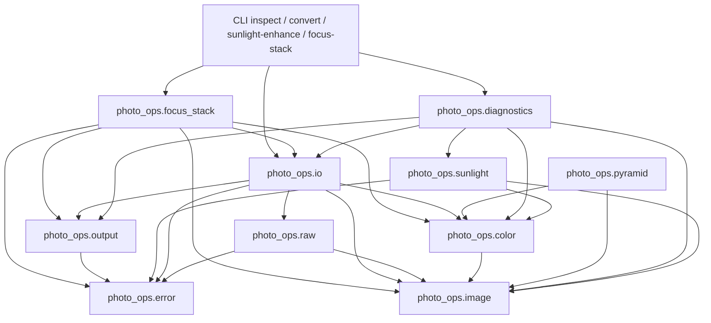

# 基础层与 module graph

当前可运行的模块依赖如下（箭头指向依赖）：



`photo_ops` 是 static library；CLI 和 tests 是独立 consumer，验证 public
module interfaces 可以跨 target 使用。第三方 headers 只出现在 implementation
的 global module fragment，公共 API 不暴露第三方类型。不使用 `import std;`
或 header units；xmake 的自动 std module 构建也显式关闭。

`photo_ops.sunlight` 已实现 classical MVP，见 [算法与诊断](sunlight-enhance.md)。
`photo_ops.focus_stack` 已实现首版 rendered-image 合成；registration 与 fusion
属于同一个模块的不同 implementation files，不预先建两个 reusable 模块。
入口编排 input preflight、spool、proxy、配准、全局选择、tiled fusion 与 streaming
输出；解码、颜色转换和最终编码继续通过 `photo_ops.io` 边界，OpenCV 仅在私有
alignment adapter 中使用。图像算法内部仍使用项目类型和借用 view。
[RAW / raw_sequence_context](raw-pipeline.md) 仍是 RAW bracket 的前置门槛；
当前 CLI 对其明确报错，不把单帧 sRGB decoder 当作 sequence-safe 开发。
详见 [focus-stack 实现与预算](focus-stack.md)。

## 目录按职责组织

```text
src/
  core/error.cppm
  image/image.cppm, pyramid.cppm
  color/color.cppm
  io/io.cppm, io.cpp, raw.cppm, raw.cpp, output.cppm, output.cpp
  sunlight/sunlight.cppm, sunlight.cpp
  focus_stack/focus_stack.cppm, alignment.cpp, focus_stack.cpp
  diagnostics/diagnostics.cppm, sunlight.cpp
  cli/main.cpp
tests/
  foundation.cpp, sunlight.cpp, focus_stack.cpp
  test_configure.py, test_cli.py, test_result_usage.py
  data/*manifest.json, *provenance.json
```

目录不是额外的 service/factory 层；named module graph 决定依赖方向。
当前单一 `photo_ops` static target 足够，不为每个目录创建独立 package。

## 图像契约

- `linear_rgb`：三个 interleaved IEEE-754 float32，linear-sRGB / D65；不以
  gamma 编码，不隐式裁到 `[0,1]`。选择 sRGB primaries 是首版明确的限制，
  并非 camera-native 或宽色域工作空间，也不是永久 ABI。未来带 encoding 的
  working image 走 linear Rec.2020/D65，不能重新解释旧类型的样本语义。
- `gray`：一个 float32；luminance proxy 使用线性相对亮度。
- `image<Pixel>`：连续存储、唯一所有权、move-only；完整拷贝必须显式 `clone()`。
  moved-from 对象为空。非法 shape／尺寸溢出属于调用违约，零尺寸只允许 `0×0`；
  文件边界先验证尺寸，再调用 constructor。
- `image_view<Pixel>`：借用 storage span，stride 的单位是 pixel。
  `image_view<const Pixel>` 只能读；mutable view 可转成 const view。
  `row()` 返回不含 padding 的 span，`subview()` 不拷贝且保留 stride。
  view 不延长 owner 生命周期，owner 移动、销毁或替换后应重新取得 view；
  禁止从临时 owner 直接取得 view。索引与 storage 覆盖范围均有检查。
- 当前像素单位是相对值，无物理辐射定标。RAW 路径使用固定处理参数，
  不进行逐帧 auto-brightening；未来 stack 必须在开发前冻结 `raw_sequence_context`，检查曝光／sensor mode，
  共用 WB、black 模型和 normalization；当前逐帧 camera WB 不满足这个要求。

`pyramid` 提供线性 luminance proxy 与 Gaussian 下采样：separable
`[1 4 6 4 1]/16`，边界 replicate，偶数坐标取样，奇数尺寸向上取整。
这为后续 registration proxy 与多尺度 focus measure 提供已测试的基础；
Laplacian 重建与 fusion 尚未实现。

## 输入与输出

| 路径 | 当前行为 |
| --- | --- |
| CR3 preferred | LibRaw，camera WB，AHD，关闭 auto-brightening、额外降噪与 gamma；16-bit linear sRGB 中间结果转 float32。可半尺寸解码用于验证 |
| TIFF supported | stripped、contiguous、top-left、无 alpha 的 8/16-bit unsigned RGB；支持压缩与 RGB ICC |
| JPEG supported | 8-bit RGB/grayscale，支持 RGB ICC；CMYK 与非 8-bit 拒绝；按文件像素方向读取，不自动 EXIF 旋转 |
| 16-bit TIFF default | sRGB transfer + embedded sRGB ICC，Deflate 无损压缩；不做 tone map，越界值裁剪 |
| EXR optional | `--exr=y` 启用；FLOAT RGB channels，linear sRGB/D65 chromaticities，保留负值与 >1 值 |
| JPEG optional | sRGB + embedded ICC，4:4:4，默认 quality 95；越界值裁剪 |
| Linear DNG | 后续再评估，未实现 |

TIFF/JPEG 有 ICC 时由 LittleCMS 转到线性工作空间，无 ICC 明确假定 sRGB 并在
诊断中说明；TIFF 有独立 transfer-function tag 而无 ICC 时拒绝，避免误猜。
TIFF 的 tiled、planar、alpha、浮点与其他 orientation 暂不支持。

**场景线性与显示线性有区别。** CR3 路径是从 RAW 开发得到的相对场景线性近似；
当前 LibRaw 16-bit 中间结果可能已裁掉高光或负值，float32 容器不能恢复这些信息。
TIFF/JPEG 的逆 transfer/ICC 转换只得到线性 RGB，不能撤销相机 tone curve、
局部处理、降噪与锐化。`decoded_image.origin` 保留这一区别，不能把 JPEG
当作真正 scene-linear RAW。真正高动态范围 RAW float 开发是后续明确改进项；focus-stack 当前只接受
rendered TIFF/JPEG，输出为 streaming 16-bit TIFF。`rendered_image_size` 为 decode
预算预检读取尺寸，JPEG header 路径最多接收 256 MiB 文件。

输出由 `photo_ops.output` 在目标同目录 `mkstemp`，encoder 完成并关闭后 fsync，
以 Linux `renameat2(RENAME_NOREPLACE)` 发布。最终路径只在完整编码后出现；所有
writer 默认拒绝覆盖（包括 dangling symlink），不依赖 CLI exists 预检查防竞态。
正常失败由 RAII 删除临时文件，SIGKILL 可能留下 `.tmp-*`；不跨 filesystem rename，
不退回会覆盖目标的方案。临时文件沿用 mkstemp 的 0600 权限。
JSON report 同样 atomic，最后发布为 diagnostics 完成标记；多个文件不是整体事务，
部分成功的 diagnostics 可保留，失败时 CLI 不发布最终照片。fsync 文件不等于
断电后的目录持久性保证，本版不承诺后者。

输出 writer 拒绝 NaN/Inf；TIFF/JPEG 默认不增加曝光、不自动美化。
diagnostics 统计非有限值、越界像素、channel range 与平均 luminance。
CLI 防止覆盖已有输出，提供 `inspect` / `convert` / `sunlight-enhance` / `focus-stack`。
可恢复错误使用 `std::expected`，调用违约使用 C++26 contracts，详见 [C++ 风格约定](cpp-style.md)。

## 验证与下一阶段

基础测试无需网络或真实照片，覆盖 view/stride/crop、溢出、move/clone、传递函数、
OKLab、Gaussian 奇数尺寸/边界/冲激响应、ICC 与 TIFF/JPEG 往返、错误文件与诊断。
真实样片按 manifest 下载，独立于默认 tests，见 [样片记录](fixtures.md)。

进入 focus-stack 时，先用静态序列验证 similarity registration 的 residual，
再做多尺度 focus evidence、空间正则化与 Laplacian fusion；不直接把 sharpness
argmax 当作最终结果。风景 CR3 的 motion、曝光/WB 一致性与 focus breathing
需要真实拍摄的回归场景，宏观样片只能覆盖其中一部分。
